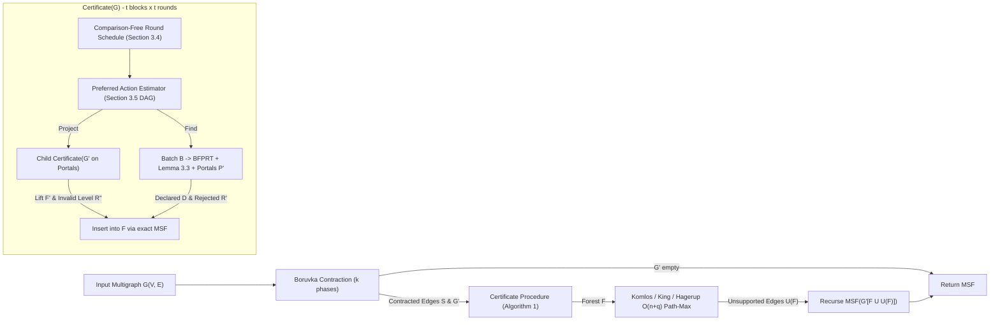

# DLMST-cpp — Deterministic Linear-Time Minimum Spanning Tree (C++20)


[](https://github.com/Louiealbp/DLMST)

> **C++20 reproduction, structural instrumentation, and empirical study of:**  
> ***A Deterministic Linear Time Algorithm for Minimum Spanning Tree***  
> Sanjeev Khanna, Aaron Putterman, and Junkai Song (November 23, 2026)  
> Original repository & manuscript: <https://github.com/Louiealbp/DLMST> (`final.pdf`)

---

## Overview / 中文简介

**English:**  
`DLMST-cpp` is a self-contained, dependency-free **C++20** implementation of the **Deterministic Linear-Time Minimum Spanning Tree (DLMST)** algorithm introduced by Khanna, Putterman, and Song (2026), which settled the worst-case deterministic comparison complexity of the **Minimum Spanning Tree / Minimum Spanning Forest (MST / MSF)** problem at $T^*(m,n) = O(m)$ and obtained an $O(m)$ deterministic algorithm via the **Pettie–Ramachandran (2002)** reduction.

This repository implements the full algorithmic stack in pure comparison-model form (accessing edge weights solely through a strict pairwise `WeightOracle`), including:
- **Borůvka vertex contraction phases** (`Definition 2.8`)
- **The recursive Certificate Procedure** (`Algorithm 1`, `Lemma 3.1`) with **Portals**, **Spokes**, **Projection Records**, and **Admissibility Rejection Propagation**
- **Deterministic BFPRT linear-time selection** (`[BFP+72]`) and **Lemma 3.3 batch representative selection** (`Section 3.2`)
- **King (1997) + Komlós (1985) / Hagerup (2009) $O(n+q)$ path-maximum queries & MST verification** (`Lemma 2.9`) for identifying unsupported edges $U(F)$
- **Comparison-DAG topological-sort action estimator** (`Section 3.5`) and a **constructive Lemma 3.11 brute-force schedule verifier** (`Section 3.4`) for small topologies

**中文简介：**  
本项目是对论文 *A Deterministic Linear Time Algorithm for Minimum Spanning Tree*（Khanna, Putterman, Song, 2026；原仓库 [`Louiealbp/DLMST`](https://github.com/Louiealbp/DLMST)）的完整 **C++20 确定性线性时间最小生成树（DLMST）** 工程复现与实验分析实现。全部权重访问均严格通过只做两两比较的 `WeightOracle` 完成，不依赖整数位运算或随机化，完整实现了 **Borůvka 缩点**、**Certificate Procedure（门户 Portals / 轮辐 Spokes / 投影可容许性检验与回传）**、**BFPRT 确定性线性选择**、**King + Komlós/Hagerup $O(n+q)$ 路径最大边验证过滤 $U(F)$**、**比较 DAG 拓扑排序动作估计器** 以及面向小图的 **Lemma 3.11 调度穷举验证器**。

**Keywords / 关键词：**  
`DLMST` · `Deterministic Linear-Time MST` · `Minimum Spanning Tree` · `Minimum Spanning Forest` · `O(m) Comparison Complexity` · `Certificate Procedure` · `Borůvka Contraction` · `BFPRT Median-of-Medians` · `Komlós / King / Hagerup Path-Maximum Queries` · `MST Verification` · `Pettie–Ramachandran (2002)` · `确定性线性时间最小生成树` · `C++20 复现`

---

## Architecture & Algorithm Flow



---

## Paper-to-Code Mapping

| Paper Section / Result | Header | Implementation Summary |
| --- | --- | --- |
| **Preliminaries & Opaque Weight Model** | [include/dlmst/types.hpp](include/dlmst/types.hpp) | `WeightOracle` enforcing strict pairwise comparisons `(weight, orig_id)`, category-level counters (`DLMSTStats`), `CertEdge`, `ProjectionStep`, `DLMSTConfig`, `DSU` |
| **Reference MSF Baseline** | [include/dlmst/kruskal.hpp](include/dlmst/kruskal.hpp) | Ground-truth `kruskal_msf` with identical tie-breaking for 100% correctness verification |
| **Deterministic Linear Selection (`[BFP+72]`)** | [include/dlmst/bfprt.hpp](include/dlmst/bfprt.hpp) | In-place, zero-allocation `bfprt_nth_element` (group-of-5 median-of-medians) in $O(m)$ worst-case comparisons |
| **Path-Maximum Queries (`Lemma 2.9`, `[Kom85]/[Kin97]/[Hag09]`)** | [include/dlmst/path_max.hpp](include/dlmst/path_max.hpp) | King's Borůvka tree + Tarjan offline LCA + Komlós/Hagerup bitmask filtering & binary search in $O(n+q)$ comparisons |
| **Borůvka Contraction (`Definition 2.8`)** | [include/dlmst/boruvka.hpp](include/dlmst/boruvka.hpp) | `run_boruvka_phases` contracting cheapest incident edges and eliminating self-loops & isolated vertices |
| **Deterministic Schedule (`Section 3.4`, `Lemma 3.11`)** | [include/dlmst/schedule.hpp](include/dlmst/schedule.hpp) | Comparison-free `build_schedule` via SplitMix64 + exhaustive small-graph `find_exact_schedule_small` verifying Lemma 3.11 across all schedules and $m!$ weight orders |
| **Batch Processing (`Section 3.2`, `Lemmas 3.2–3.3`)** | [include/dlmst/batch_processor.hpp](include/dlmst/batch_processor.hpp) | Recursive Lemma 3.3 $k$-lightest admissible representative selection, cached projection admissibility tests, $\le 2n/r$ hitting-set portal construction $P'$, and spoke updates |
| **Preferred Action Estimation (`Section 3.5`, `Claim 3.12`)** | [include/dlmst/action_estimator.hpp](include/dlmst/action_estimator.hpp) | `DAGTopological` mode: queries deterministic sample $S^*$ on $F$, records all comparisons into a DAG on $T = F \cup \{\sigma(v)\}$, runs Kahn topological sort (0 comparisons), and resolves all remaining ambiguous edges with 0 real weight comparisons |
| **Certificate & MSF (`Algorithms 1 & 2`, `Claim 3.5`, `Lemma 3.7`)** | [include/dlmst/dlmst.hpp](include/dlmst/dlmst.hpp) | Mutual recursion between `certificate_recursive` and `msf_recursive`, edge lifting, first-invalid-level rejection propagation ($R''$ vs $R'\setminus R''$), $U(F)$ filtering, and optional `verify_invariants` assertions for Claim 3.5 & Lemma 3.2 |

---

## Implementation Highlights & Theory vs. Engineering Note

The paper establishes $T^*(m,n) = O(m)$ in the **deterministic comparison-tree model** and derives a uniform $O(m)$-time algorithm via the **Pettie–Ramachandran (2002)** optimal micro-tree lookup theorem. In the pure theoretical proof:
1. Choosing the deterministic schedule $\rho^*$ (`Lemma 3.11`) and distinguishing subset $S^*$ (`Claim 3.12`) invoke comparison-free exhaustive enumeration over exponentially many histories/schedules.
2. The asymptotic parameter choices $t = \gamma d^3, r = 8t^3, k = r^2$ (`Lemma 3.1`) yield $k \ge 4096$ at depth 1 and millions at deeper levels, requiring astronomically large graphs before portals ever form.

To preserve **100% algorithmic fidelity** while remaining **fast, polynomial-time executable, and thoroughly testable** on real graphs:
- **`ParamSchedule::PaperAsymptotic`** faithfully uses $t = \max(2, \gamma d^3), r = 8t^3, k = r^2$.
- **`ParamSchedule::Practical`** ($t = 2 + d, r = 2t + 2, k = r^2$) and **`ParamSchedule::DeepStress`** ($t = 2, r = 5, k = 25$) preserve the critical contraction invariant $2t/r < 1$ (shrinking portals every level) while genuinely triggering multi-level portal projection (`depth >= 2`), admissibility failures, and rejection propagation on moderate-size graphs.
- **`EstimatorMode::DAGTopological`** turns the theoretical existence proof of Section 3.5 into a concrete polynomial-time algorithm: comparisons performed while querying $S^*$ form an acyclic precedence DAG on $T = F \cup \{\sigma(v)\}$, whose topological sort resolves the remaining edges in $A_i$ with **zero additional real weight comparisons** while guaranteeing 100% agreement on $S^*$.
- **`find_exact_schedule_small`** constructively verifies Lemma 3.11 by exhaustively checking all $(t^2)^m$ schedules against all $m!$ weight permutations on small graphs such as $K_4$.

---

## Quick Start

### Prerequisites
- `g++` (GCC 11+ or Clang with C++20 support; tested with `g++ 13.3.0`)
- `make`

### Build, Test & Benchmark

```bash
git clone https://github.com/au1bhi/DLMST-cpp.git
cd DLMST-cpp

make test   # Compile with -std=c++20 -O2 -Wall -Wextra -Wpedantic and run all 6 test suites
make asan   # Run full test suite under AddressSanitizer + UndefinedBehaviorSanitizer
make bench  # Build and run comparison-breakdown & scaling benchmarks
```

### Minimal C++20 API Usage

```cpp
#include "dlmst/dlmst.hpp"
#include "dlmst/kruskal.hpp"

int main() {
    dlmst::Graph g;
    g.n = 4;
    g.edges = {{0, 1, 0}, {1, 2, 1}, {2, 3, 2}, {0, 3, 3}, {0, 2, 4}};
    g.weights = {1.0, 2.0, 3.0, 4.0, 2.5};

    dlmst::DLMSTConfig cfg;
    cfg.boruvka_steps = 4;
    cfg.param_schedule = dlmst::ParamSchedule::Practical;
    cfg.estimator_mode = dlmst::EstimatorMode::DAGTopological;
    cfg.verify_invariants = true;

    dlmst::MSFResult res = dlmst::dlmst_msf(g, cfg);
    // res.edge_ids == dlmst::kruskal_msf(g)
    // res.stats.total_comparisons() gives exact pairwise comparison count
}
```

---

## Verified Test & Benchmark Results

All checks below were compiled with `-Wall -Wextra -Wpedantic` (zero warnings) and verified under both `-O2` and `-fsanitize=address,undefined`:

### 1. Unit, Invariant & Component Tests (`make test` & `make asan`)
- **BFPRT Deterministic Selection**: 200 random/sorted/reverse/duplicate-key arrays matched `std::sort` 100%; for $n = 10{,}000$, BFPRT used **80,297** comparisons ($8.03n$).
- **King + Komlós/Hagerup `path_max_queries`**: 100% exact match against naive BFS across 40 varied trees/paths/stars/caterpillars/disconnected forests; for $n = 2{,}000, q = 10{,}000$, used **15,756** comparisons ($C/(n+q) = \mathbf{1.313}$) and verified **100% DAG-dominance consistency**.
- **Batch Processor (Lemmas 3.2 & 3.3)**: 30 randomized multigraph trials with mixed admissibility matched brute-force selection 100%; batch portal test produced $|P'| = 7 \le 32$ and $|D| = 1077$ satisfying Lemma 3.2.
- **Constructive Lemma 3.11 Schedule Search on $K_4$**: Exhaustively evaluated all **4,096** schedules $\times$ **720** permutations ($6!$), finding a deterministic schedule with **0/6** worst-case bad-round edges.
- **Action Estimator (`DAGTopological` 25% sub-sampling)**: Queried **717 / 2,871** ambiguous edges, saved **5,314** comparisons vs. exact querying, achieved **100%** agreement on $S^*$ and **98.875%** agreement on the full ambiguous set.
- **End-to-End & `DeepStress` Invariants**: Matched `kruskal_msf` 100% across degenerate graphs (empty, isolated, single-edge, loops-only, all-equal tie-breaking, negative/adversarial weights) and families (ER sparse/dense, $K_{80}$, $30\times 30$ grid, Barabási–Albert hub, multigraphs) across `Practical`, `PaperAsymptotic`, `Exact`, and `DeepStress` (`max_cert_depth = 2`, `portals = 3`, `projected = 14`, `rejected = 1`, `dag_invocations = 2`, Claim 3.5 & Lemma 3.2 runtime assertions passing).

### 2. Scaling & Comparison Breakdown Benchmarks (`make bench`)

| Family | $n$ | $m$ | DLMST Cmps | $C/m$ | Kruskal Cmps | $K/m$ | Borůvka Cmps | Time (ms) | `Depth` | `Portals` | Status |
| :--- | ---: | ---: | ---: | ---: | ---: | ---: | ---: | ---: | ---: | ---: | :--- |
| Sparse ($m=4n$) | 2,000 | 8,000 | 143,879 | 17.98 | 124,469 | 15.56 | 56,569 | 1.6 | 1 | 0 | PASS |
| Sparse ($m=4n$) | 10,000 | 40,000 | 904,899 | 22.62 | 746,807 | 18.67 | 339,715 | 10.3 | 1 | 0 | PASS |
| Sparse ($m=4n$) | 50,000 | 200,000 | 5,315,859 | 26.58 | 4,194,919 | 20.97 | 1,888,522 | 78.3 | 1 | 4 | PASS |
| Medium ($m=16n$) | 2,000 | 32,000 | 833,003 | 26.03 | 577,444 | 18.05 | 276,278 | 6.3 | 1 | 0 | PASS |
| Medium ($m=16n$) | 10,000 | 160,000 | 5,163,695 | 32.27 | 3,376,123 | 21.10 | 1,468,694 | 50.2 | 1 | 0 | PASS |
| Dense ($m=50n$) | 1,000 | 50,000 | 1,602,216 | 32.04 | 941,792 | 18.84 | 417,489 | 15.8 | 1 | 4 | PASS |
| Dense ($m=50n$) | 3,000 | 150,000 | 5,040,535 | 33.60 | 3,124,089 | 20.83 | 1,321,100 | 68.3 | 2 | 11 | PASS |
| Multi ($m=40n$) | 2,000 | 80,000 | 2,596,707 | 32.46 | 1,544,120 | 19.30 | 634,667 | 31.0 | 2 | 9 | PASS |

---

## Project Structure

```text
DLMST-cpp/
├── .gitignore
├── LICENSE
├── Makefile
├── README.md
├── include/dlmst/
│   ├── action_estimator.hpp
│   ├── batch_processor.hpp
│   ├── bfprt.hpp
│   ├── boruvka.hpp
│   ├── dlmst.hpp
│   ├── kruskal.hpp
│   ├── path_max.hpp
│   ├── schedule.hpp
│   └── types.hpp
├── src/
│   └── main.cpp
└── tests/
    └── test_dlmst.cpp
```

---

## References

1. **S. Khanna, A. Putterman, J. Song (2026)** — *A Deterministic Linear Time Algorithm for Minimum Spanning Tree*. [`Louiealbp/DLMST`](https://github.com/Louiealbp/DLMST)
2. **S. Pettie, V. Ramachandran (2002)** — *An optimal minimum spanning tree algorithm*. Journal of the ACM, 49(1):16–34.
3. **B. Chazelle (2000)** — *A minimum spanning tree algorithm with inverse-Ackermann type complexity*. Journal of the ACM, 47(6):1028–1047.
4. **T. Hagerup (2009)** — *An even simpler linear-time algorithm for verifying minimum spanning trees*. WG 2009, LNCS 5911:178–189.
5. **V. King (1997)** — *A simpler minimum spanning tree verification algorithm*. Algorithmica, 18(2):263–270.
6. **J. Komlós (1985)** — *Linear verification for spanning trees*. Combinatorica, 5(1):57–65.
7. **M. Blum, R. W. Floyd, V. Pratt, R. L. Rivest, R. E. Tarjan (1972)** — *Time bounds for selection*. JCSS / STOC 1972.
8. **O. Borůvka (1926)** — *O jistém problému minimálním*.

## License

Released under the [MIT License](LICENSE).
